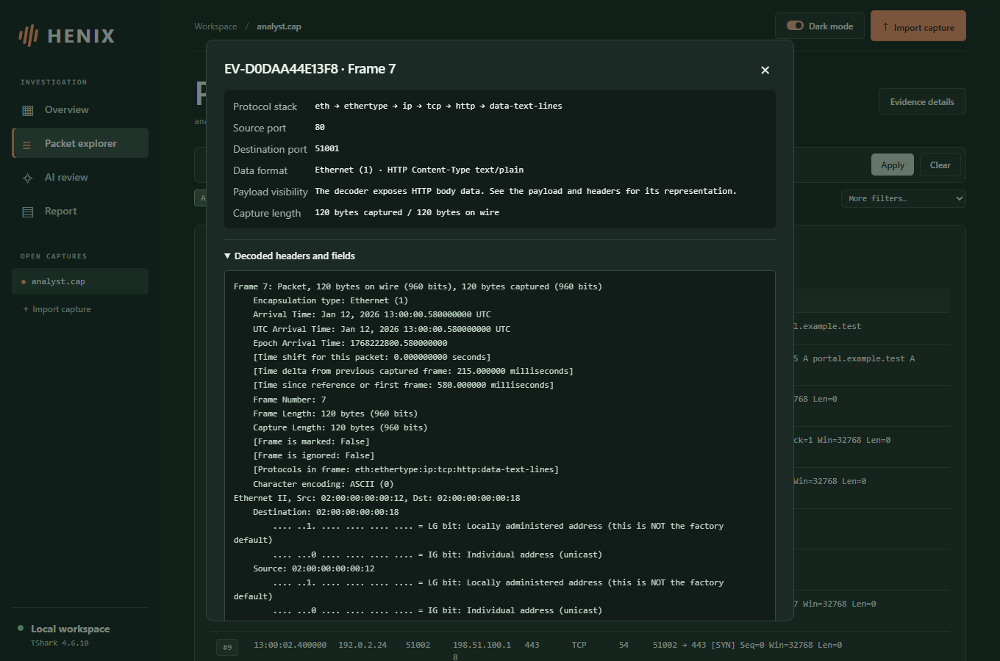

# HENIX

**A local packet investigation workspace for security analysts and network engineers.** Trace a connection through a capture of up to **5 GiB**, pin the packets behind your conclusion and hand the investigation to a colleague. HENIX pairs TShark dissection with a disk-backed SQLite index. Each packet reference retains its original frame number and capture ID.

[Quick start](#quick-start) · [Investigation workflow](#investigation-workflow) · [Cases and reports](#cases-and-reports) · [Capacity measurements](#capacity-measurements) · [AI and data handling](#ai-and-data-handling) · [Verification](#verification)



*An HTTP response from the test fixture. Frame 7 shows traffic from port 80 to port 51001, a text/plain body, and all 120 on-wire bytes present in the capture.*

## Investigation workflow

**Example analyst question** — A workstation contacted an unfamiliar address. What name did it resolve, which service did it reach, and what did the capture actually reveal?

| Step | What the analyst does | Evidence for the handoff |
| --- | --- | --- |
| Establish scope | Import a `.cap`, `.pcap` or `.pcapng` file. Record its source and acquisition date. | Original filename, SHA-256, evidence ID and UTC capture window. |
| Trace the connection | Inspect a DNS reply, then search the TCP conversations by address, port or stream ID. Open a stream to scope Packet Explorer. | Query, reply and connection frames from the same capture. |
| Inspect the exchange | Open a frame to examine its protocol stack, ports, decoded headers, payload and hex/ASCII bytes. | An HTTP method or status when visible, or the fields exposed by a TLS handshake. |
| Record your assessment | Pin a frame, finding or the first and last matching frames of a TCP conversation. Add a note and a conclusion under **Report**. | Capture-wide analyst notes and the original frame references, including pins outside the current filter. |
| Hand off the case | Export a report for readers or save a portable case for another analyst. | A scoped report, a timeline and manifest for review, or a full case that opens in HENIX. |

To link packets across conversations, open **Report → Pin frame numbers**. Enter up to 32 original frame numbers separated by commas or spaces, add a shared note, and save the pin. A reviewer can open each cited packet from the pin after reopening the case. Importing identical capture bytes under another filename or source adds an acquisition record to the same evidence ID.

A DNS answer followed by a connection to the returned IP supports an association. Identifying the process that opened the connection requires endpoint telemetry. HENIX keeps that distinction visible in the report.

### Useful display filters

| Investigation question | Wireshark filter |
| --- | --- |
| Which DNS replies are visible? | `dns.flags.response == 1` |
| What happened in one TCP conversation? | `tcp.stream == 0` (substitute the observed stream ID) |
| Which HTTP requests or responses were decoded? | `http.request || http.response` |
| Which frames contain a TLS Client Hello? | `tls.handshake.type == 1` |
| Where did capture truncation limit visibility? | `frame.cap_len < frame.len` |

Packet Explorer, statistics, AI evidence previews and reports share the applied filter. Enter `frame.number == N` to jump to a cited frame using the index.

## Cases and reports

| Deliverable | Where to find it | What it contains |
| --- | --- | --- |
| Standalone HTML | **Report → Download HTML** | A print-ready investigation with evidence identity, acquisition history, protocol inventory, observed flow, findings, pins, conclusion and approved AI observations for the current filter. |
| Report ZIP | **Report → Export casefile .zip** | The HTML report, CSV evidence manifest and timeline, display filters and a flow diagram when there are timeline events. |
| Portable workspace | **Case files → Download .henix case** | The original packet bytes, reusable SQLite index, acquisition history, applied filter, pins, conclusion and saved provider reviews, including original responses and approval choices. |

To resume after restarting HENIX, choose **Case files → Open saved case** and select a `.henix` file. HENIX checks the archive checksum and capture SHA-256, validates the stored index and reuses it when the index format and decoder settings match. A decoder or format change triggers a rebuild. Select **Rebuild index from the original capture** to independently decode a case received from another source.

Case checksums detect corruption. Authenticating the sender requires a trusted transfer or an independently obtained digest. A portable case contains the original traffic and review history in readable form. Store and transfer it with the same access controls as the capture.

## Quick start

Install **Python 3.10+** and **Wireshark 4.4+ with TShark**. HENIX uses the Python standard library. [Wireshark downloads](https://www.wireshark.org/download.html)

```sh
git clone https://github.com/VadherHenil/network-traffic-investigation.git
cd network-traffic-investigation
python app.py
```

The app opens in your browser at `http://127.0.0.1:8765` by default. Choose **Import capture** to begin. On Windows, you can also double-click **Start HENIX.cmd**. Keep the console open during the session. Use the light/dark mode button to set the browser's local theme.

| Setting | When to use it |
| --- | --- |
| `python app.py --work-dir "D:\HENIX-Work"` | Put working copies and indexes on an existing directory with sufficient free space. |
| `python app.py --port 0 --no-browser` | Choose a free local port and print the address without opening a tab. |
| `TSHARK_PATH` | Point HENIX to a TShark executable outside its standard installation locations. |
| `HENIX_AI_ALLOWED_ORIGINS` | Restrict AI destinations to a comma-separated list of approved URL origins. |

## Capacity measurements

HENIX accepts **up to 5 GiB per capture**. Python streams the upload to disk while calculating SHA-256. TShark decodes the frames and SQLite indexes their metadata for paginated inspection. Up to eight captures can be open. One import runs at a time, and previously indexed files remain available during indexing. The browser shows upload and indexing progress and can resume monitoring after a refresh. Analysts can cancel indexing, long filter queries and frame inspections.

These Windows measurements use Python 3.12 and TShark 4.6.10. Each generated capture contains a small DNS, TCP, HTTP and TLS fixture followed by UDP records of the indicated size. “Final frame” measures the first detailed lookup with an empty frame cache.

| Capture / record size | Frames | Upload and index | Final frame | Peak Python / TShark RSS | Peak workspace files |
| --- | ---: | ---: | ---: | ---: | ---: |
| 41 MiB / 96 B | 447,393 | 17.3 s | 17.4 s | 96 / 192 MiB | 149 MiB |
| 82 MiB / 8 KiB | 10,498 | 2.3 s | 5.7 s | 95 / 102 MiB | 85 MiB |
| 5 GiB / 8 KiB | 655,372 | 125.7 s | 130.5 s | 97 / 236 MiB | 5.16 GiB |

The full 5 GiB check took 386 seconds, including filtering, dissection, reporting and cleanup. Memory and workspace file sizes were sampled every 250 ms. The workspace total includes the capture copy and index. Allow additional space for system temporary files. Packet density, protocol mix, local disk and decoder version affect these results.

<details>
<summary><strong>Dissection and display limits</strong></summary>

Files over 32 MiB use single-pass dissection for indexing and frame inspection, so a request may lack a forward reference to a later response. Smaller files use two passes. General display filters use two-pass dissection. The overview counts every decoded protocol layer and displays up to 100 TCP streams and 4,096 protocol hierarchy paths. **Search all streams** pages through matching TCP conversations beyond that initial list. Byte budgets limit retained filter results and recently inspected frames. A cache miss can require another capture scan.

Packet detail shows the source and destination ports supplied by the dissector, protocol stack, captured and on-wire lengths, decoded headers, payload visibility and hex/ASCII bytes. Encryption, packet truncation, missing traffic and dissector coverage determine which fields and application data are visible.

</details>

## AI and data handling

**Local investigation works offline.** The server binds to IPv4 loopback for use from the analyst's workstation. HENIX keeps working copies and indexes in a temporary session directory. Download a `.henix` case before closing the capture or stopping the server to retain an editable investigation. Normal shutdown clears the session directory.

**AI review is optional.** Built-in choices include OpenAI, Anthropic Claude, Google AI Studio Gemini, xAI Grok, Groq, DeepSeek and OpenRouter. Set a model ID available to your account. Under **AI review**, preview the destination, headers with the key omitted, and exact JSON request body before sending. Changing the provider settings, redaction option or evidence scope requires a fresh preview. The app clears the API key from the form on submission and keeps it out of saved cases and exports.

Redaction is enabled by default. It replaces endpoints with per-excerpt aliases, suppresses filter text and names, and retains UTC timestamps, protocol labels, evidence ID, frame numbers and selected numeric fields. Turning it off can disclose internal addresses, names and filter values. The excerpt supplies metadata from up to 40 matching frames. Inspect the preview to see precisely what the provider will receive.

HENIX checks each returned observation's evidence ID and cited frames against the submitted excerpt. Review the packet references and approve the observations you want to include in reports. Citation checks establish that a frame was supplied. The analyst assesses whether it supports the claim. The original response remains available for inspection in the workspace.

For an internal gateway, choose **Custom endpoint**, enter the full inference URL and select Chat Completions, Responses, Anthropic Messages or Gemini generateContent. Choose the key header required by the gateway. Gemini-format URLs use `{model}` in the path. Remote endpoints use HTTPS. Loopback endpoints can use HTTP.

Set the following environment variable before starting the server to enforce an organization policy for built-in and custom providers. Entries match the scheme, hostname and port. An unset variable allows all supported destinations. An explicitly empty value blocks all provider requests.

```powershell
$env:HENIX_AI_ALLOWED_ORIGINS = "https://api.openai.com,https://ai-gateway.example.org:8443"
python app.py
```

## Verification

Run the regression suite from the project directory. Decoder tests use real TShark dissection. Provider tests use simulated responses and require no credentials.

```sh
python -m unittest discover -s tests -v
```

For browser coverage, install Node.js and the test-only Playwright dependency. The launcher starts an isolated loopback workspace, exercises packet inspection, AI approvals and case handoff with a local provider fixture, then checks large-upload status and pagination using simulated 5 GiB file metadata.

```sh
npm install --no-save --package-lock=false playwright
npx playwright install chromium
python -m tests.browser_check
```

Set `PLAYWRIGHT_MODULE` and `CHROME_PATH` to use an existing Playwright module and Chromium-compatible browser. To transfer and index an actual 5 GiB capture, run the capacity check below with an existing scratch directory. The check verifies SHA-256, frame count, final packet page, general filtering, late-frame inspection, AI excerpt, HTML and ZIP exports, and cleanup. The optional metrics file records sampled Python and TShark resident memory, workspace bytes and operation durations.

```powershell
python -m pip install psutil
python -m tests.large_capture_check --gib 5 --work-dir "D:\HENIX-Work" --metrics measurements/full-capacity.json
```

For a denser workload of approximately 3.5 million frames, add `--record-size 1530`. The metrics option uses `psutil`. Application operation and capacity checks without metrics use the Python standard library. [Capacity test implementation](tests/large_capture_check.py)

GitHub Actions runs unit and browser regressions and short- and large-packet benchmarks. Version tags additionally run the full-capacity check before the release job publishes its measurements. [Verification workflow](.github/workflows/verify.yml) · [Version 1.0.0 release notes](docs/releases/v1.0.0.md)
